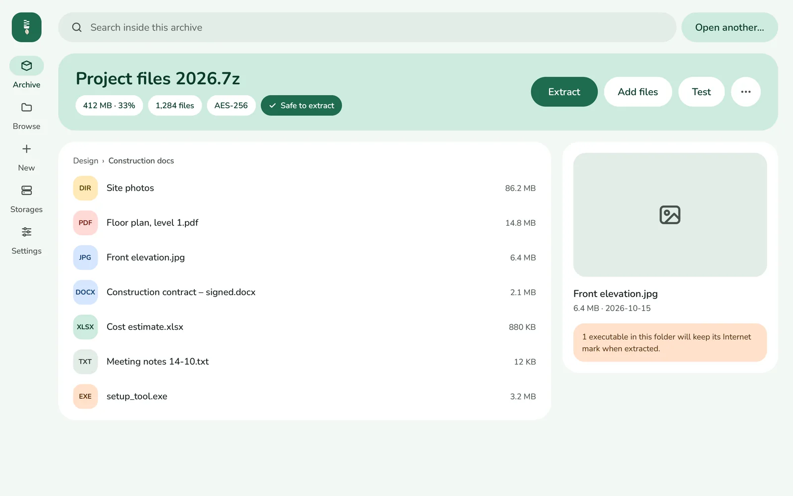
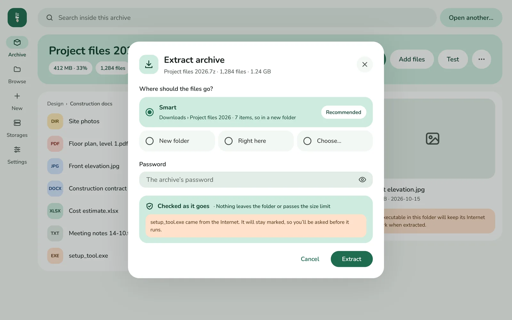
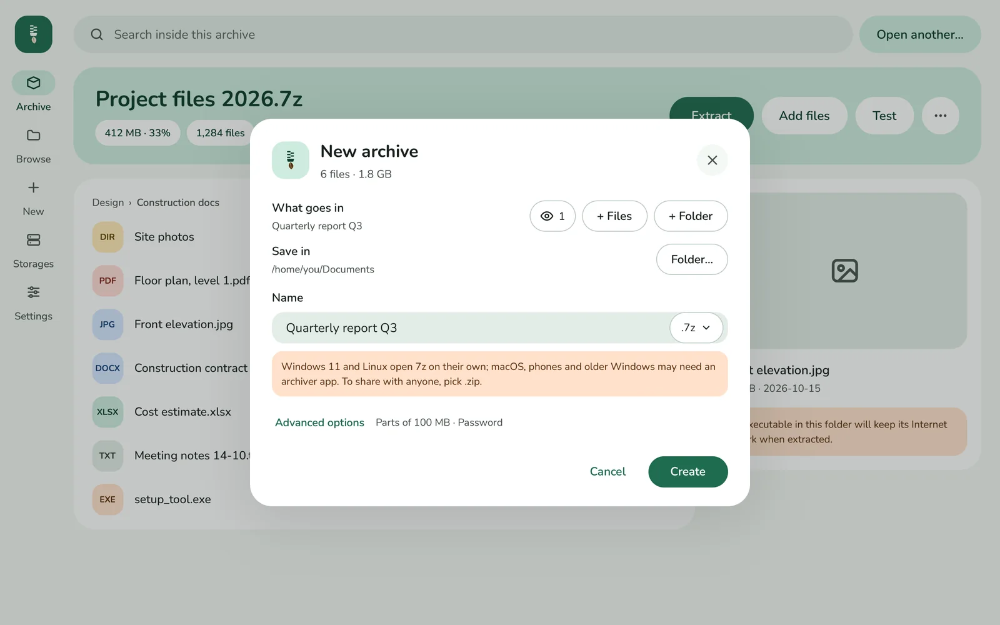
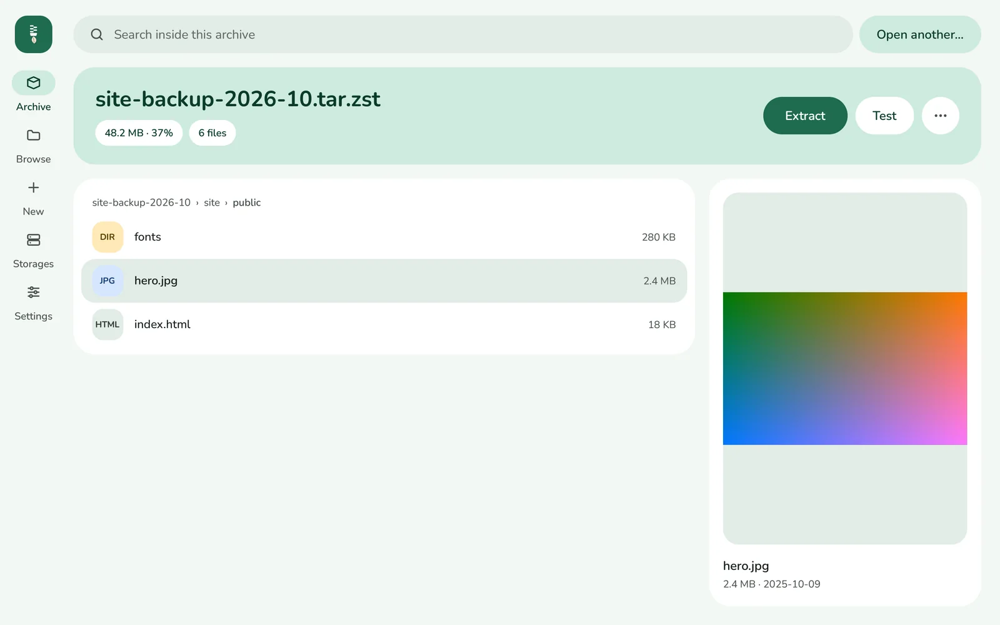
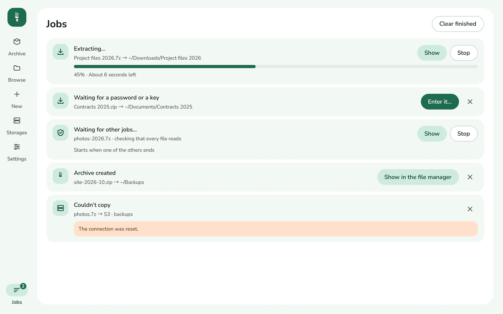

<p align="center">
  
</p>

<h1 align="center">packwing</h1>

<p align="center">
  <b>The file archiver that uses every core you have.</b><br>
  ZIP, 7z, RAR, tar and more: made fast, opened safely. For macOS, Windows and Linux.
</p>

<p align="center">
  <a href="https://packwing.app"><b>packwing.app</b></a> ·
  <a href="https://packwing.app/#get">Download</a> ·
  <a href="https://github.com/hivepaas/packwing/releases">Releases</a> ·
  <a href="docs/cli.md">Command line</a>
</p>

<p align="center">
  <a href="https://github.com/hivepaas/packwing/releases/latest"></a>
  <a href="LICENSE"></a>
  
</p>

<p align="center">
  
</p>

## Why packwing

- ⚡ **Every core at work.** Compresses and extracts on all of your computer's cores at once: one 3 GB file zipped in 3.2 seconds, where a single core takes 65.
- 🛡️ **Safe by default.** Nothing is written outside the folder you chose, archive bombs are stopped, and no file is replaced without asking.
- 📂 **Opens what you come across.** ZIP, RAR, 7z, tar, ISO and UDF images, Debian and RPM packages, snaps, AppImages, macOS packages and `.age` files.
- ✏️ **Makes and edits archives.** ZIP, 7z and `.tar.gz`, `.tar.xz`, `.tar.zst`, `.tar.bz2`, with AES-256. Add, delete and rename inside ZIP and 7z archives.
- 👀 **Look before you extract.** Search inside an archive, preview its files, and step through its pictures and texts in a full-window viewer.
- ☁️ **Your storages, too.** Browse S3, WebDAV and SFTP like folders, and open an archive there without downloading it.
- 🔏 **Signed and checked.** Sign files, verify signatures, and compare checksums with the ones on a download page.
- 🖱️ **Right where you are.** Compress and Extract in the right-click menu of Finder, Windows Explorer and Linux file managers.
- ⌨️ **`pkw`, the command line.** The same engine for terminals, servers and scripts.
- 🏢 **Ready for organizations.** Policies by Group Policy or a configuration profile, and an audit log of what was extracted and made.
- 🌍 **Made for every day.** 15 languages, light and dark, and updates you can trust.

Every feature in detail: [docs/features.md](docs/features.md).

<table>
  <tr>
    <td></td>
    <td></td>
  </tr>
  <tr>
    <td></td>
    <td></td>
  </tr>
</table>

## Download

Get packwing at **[packwing.app](https://packwing.app/#get)**, or from the [latest release](https://github.com/hivepaas/packwing/releases/latest):

| System | |
| --- | --- |
| **macOS** 13 or later | `.dmg` for Apple silicon and Intel, signed and notarized |
| **Windows** 10 and 11 | an installer, or a `.zip` to run from a folder |
| **Linux** | `.deb` for Debian and Ubuntu, `.rpm` for Fedora and openSUSE |
| **Command line only** | `pkw` alone, for Linux, macOS and Windows, or `brew install hivepaas/tap/pkw` |

On macOS, `brew install --cask hivepaas/tap/packwing` installs the app with [Homebrew](https://brew.sh).

packwing tells you when a new version is out, and installs it when you say so.

## Command line

```sh
pkw extract backup.7z
pkw create site.tar.zst site/
pkw convert photos.rar photos.tar.zst
```

Everything `pkw` does: [docs/cli.md](docs/cli.md).

## Build from source

```sh
make release
```

What it needs, the tests and the packages: [docs/building.md](docs/building.md).

## 🐝 Made by HivePaaS

packwing is built on [hivepack](https://github.com/hivepaas/hivepack-rs), our Rust library for archives and compressed files. HivePaaS also makes [shellwing](https://shellwing.app), a fast native SSH client, [tracewing](https://tracewing.app), a native HTTP(S) debugging proxy, [authwing](https://github.com/hivepaas/authwing), two-factor codes that know the window you are in, [context-menu-rs](https://github.com/hivepaas/context-menu-rs) and [hivepaas](https://github.com/hivepaas/hivepaas), a self-hosted PaaS.

⭐ If packwing is useful to you, a star on GitHub helps others find it.

## License

packwing is free software under the [GNU General Public License, version 3](LICENSE) or later, with the [additional permission](GPL-ADDITIONAL-PERMISSION.md) that lets it read RAR. The name and logo are not covered by the GPL: see [TRADEMARKS.md](TRADEMARKS.md). Contributions are welcome: see [CONTRIBUTING.md](CONTRIBUTING.md). The licenses of what packwing is built with: [docs/third-party.md](docs/third-party.md).

Copyright © 2026 HivePaaS.
